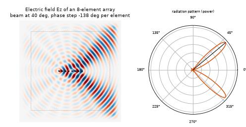
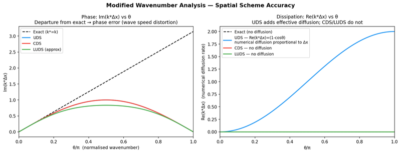
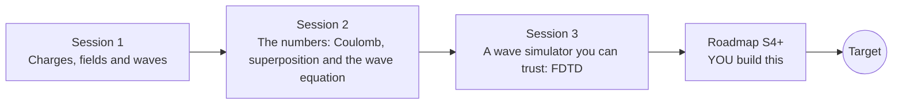

# openemwave

[](https://github.com/KrunalPanchal1995/openemwave/actions/workflows/ci.yml)   [](https://colab.research.google.com/github/KrunalPanchal1995/openemwave/blob/main/sessions/session-01/lesson.ipynb) [](https://krunalpanchal1995.github.io/openemwave/)

**Watch an antenna radiate: electric and magnetic fields, in three sessions.**

openemwave teaches electric fields, waves and antennas, from Coulomb's law to your own FDTD simulator, using only Python and a browser.

- **Start from zero.** Session 1 needs only school arithmetic: charges push, waves travel, speed = frequency x wavelength.
- **See it radiate.** Every session ships a slider app that runs in the browser, with labelled graphs and a polar pattern.
- **Know you got it right.** Session 3 builds a wave simulator and checks it against theory: wave speed, stability, energy, fall-off, standing waves.
- **Build the missing half.** The repo stops at two sources on purpose; the roadmap shows the path to a steerable antenna array.

[Target](#the-target) · [Who is this for](#who-is-this-for) · [Quick start](#quick-start) · [Sessions](#sessions) · [Roadmap](#roadmap) · [Contribute](#contribute) · [Explainer PDF](docs/explainer.pdf)

> **This repo is incomplete on purpose.** Sessions 1 to 3 are here and fully working. The finished Target below is a preview of what the community can build next. We show you the path, not the code. Sessions 4 and up are yours.

## The Target

A row of eight small antennas radiates into a simulated box. The colour map is the electric field Ez (red and blue are opposite signs). Each antenna is driven a little later than its neighbour, and as that delay is changed the beam swings from 40 to 140 degrees without anything moving. On the right, the polar radiation pattern shows the same beam as a narrow lobe. Your goal over the coming sessions: go from the two sources of Session 3 to a steerable array like this.



*Target: an 8-element antenna array whose beam is steered by phase shifting*


*CFD numerics teaching project: a scheme is stable below its CFL limit and blows up above it (same idea as our Courant condition)*



*CFD numerics teaching project: how a grid distorts short waves (numerical dispersion, as in Session 3)*

Try it live:

- [Math Visual Studio: the Studio, where Maxwell's equations and the electromagnetic-wave project live (Atlas S72, S105)](https://krunalpanchal1995.github.io/studio/)

How the Target was made is shown only as a path in [promo/roadmap.md](promo/roadmap.md).

## Who is this for
**secondary school to diploma / undergraduate (levels 3-5).** Topic area: Electricity, Magnetism and Electronics.

Prerequisites:

- School arithmetic, powers and the sine function (a graph of sin is enough).
- Python 3.10 or newer; if `python --version` works, you are ready. PRIMER.md explains the rest.
- No prior GitHub, physics of electricity or numerical-methods experience is needed.

New to Python? Read [PRIMER.md](PRIMER.md) first (10 minutes).

## Quick start

No installation knowledge needed. You need [Git](https://git-scm.com/downloads) and [Python 3.10+](https://www.python.org/downloads/) (Windows: tick "Add Python to PATH"). On Mac and Linux type `python3` wherever this page says `python`.

```bash
git clone https://github.com/KrunalPanchal1995/openemwave.git
cd openemwave
python start.py 1
```

`start.py` creates a private environment, installs what is needed and runs Session 1 with its checkpoint. Next: `python start.py 2`, `python start.py 3`, or `python start.py test` to check everything. Only a checkpoint: `python start.py check 1`.

Three lines turn the idea of Session 2 into a result (they work as they are): Save it as `try.py` and run it with `python start.py run try.py` (this uses the private environment, where NumPy is installed):

```python
import numpy as np
c, f = 299792458.0, 100e6                   # speed of light (m/s), an FM station at 100 MHz
lam = c / f                                 # wavelength in metres
print(round(lam, 3), 'm wavelength;', round(lam / 2, 3), 'm half-wave antenna')   # -> 2.998 m ; 1.499 m
```

Every session also opens in your browser with sliders (no install): [live apps](https://krunalpanchal1995.github.io/openemwave/). Or use the Colab badge above for the notebook.

## Sessions

| # | Session | Model level | Time | Live app |
|---|---|---|---|---|
| 1 | [Charges, fields and waves](sessions/session-01/README.md) | Level 1: conceptual interactive model | 60 min | [open](https://krunalpanchal1995.github.io/openemwave/session-01/) |
| 2 | [The numbers: Coulomb, superposition and the wave equation](sessions/session-02/README.md) | Level 2: mathematical engineering model | 75 min | [open](https://krunalpanchal1995.github.io/openemwave/session-02/) |
| 3 | [A wave simulator you can trust: FDTD](sessions/session-03/README.md) | Level 3: simulation and validation | 90 min | [open](https://krunalpanchal1995.github.io/openemwave/session-03/) |

Each session follows the same six steps: A real-world problem, B concept and theory, C visual explanation, D interactive simulation, E worked example and experiment, F assessment and design challenge. Each ends with `checkpoint.py`, which prints `PASS` or `FAIL` against reference numbers. Session 3 also contains the real-world mini-project: **Steer a beam with two sources**.

## Architecture



| Folder or file | What is inside |
|---|---|
| `sessions/` | three sessions: README (A-F), `lesson.py`, notebook, live app, exercises, activity sheet, checkpoint |
| `promo/` | the Target: media, live links, and the roadmap (path only) |
| `docs/` | `explainer.tex` and the built `explainer.pdf` |
| `tests/` | runs every lesson and checkpoint headless |
| `start.py` | one command to set up and run anything |
| `QUALITY.md`, `RUBRIC.md` | the quality checklist and the scoring rubric |
| `.github/` | CI, PDF build, Pages deploy, issue and PR templates |

## Roadmap

| Milestone | What you will build | Difficulty |
|---|---|---|
| Session 4: An 8-element steerable array | A function that drives N sources with a progressive phase and measures the beam in the simulation. | intermediate |
| Session 5: A better absorbing boundary | A matched absorbing layer around the grid. | advanced |
| Session 6: A dielectric slab | A grid with a permittivity map and a slab of refractive index 2. | intermediate |
| Session 7: Go 3D: a point source | A 3D FDTD solver with a small radiating source. | advanced |
| Session 8: Animate and share the beam | A looping GIF of a steered beam. | beginner |

Full detail with a checkpoint per milestone: [promo/roadmap.md](promo/roadmap.md).

## Contribute
New to GitHub? Read [CONTRIBUTING.md](CONTRIBUTING.md); it starts from zero. Pick an issue labelled `good first issue`. Translations into Hindi, Telugu, Tamil and Malayalam are welcome.

<details>
<summary>Development</summary>

```bash
python start.py test        # runs every lesson and checkpoint
```
Lessons use `# %%` cell markers so they open as notebooks in VS Code. See [QUALITY.md](QUALITY.md) for the standard every session meets.
</details>

## License
MIT. See [LICENSE](LICENSE). Media in `promo/media` is (c) Krunal Panchal, CC BY 4.0.

## Acknowledgments
Part of the [PAN IIT OSS](https://hellofoss.tech-iitb.org/projects) open-source teaching collection, modelled on the structure of [openspline](https://github.com/openspline/openspline). Built on ideas from the Math Visual Studio at https://krunalpanchal1995.github.io/studio/.
