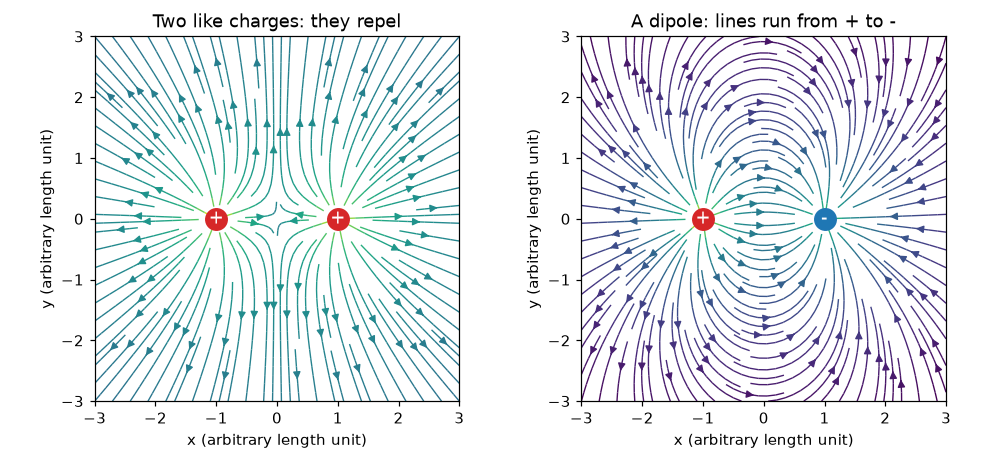
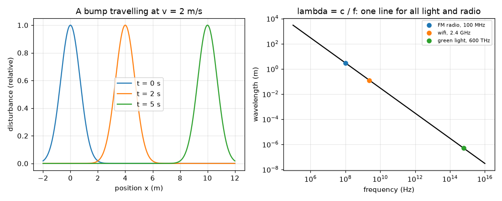

# Session 1: Charges, fields and waves

*Level 1 (conceptual interactive model) · about 60 minutes · openemwave*

> This is a simplified educational model. It is not a validated design tool and must not be used for real structures, electrical installations, vehicles, industrial processes or medical decisions.

**Prerequisites**

- School arithmetic and the idea of a graph.
- You have read PRIMER.md and run `python start.py 1` once.

**Learning objectives.** After this session you can:

- Say what like and opposite charges do, and draw the field of two like charges and of a dipole.
- Explain a wave as a disturbance that travels, and read wavelength and frequency from it.
- Use speed = frequency x wavelength for radio and light.
- State that radio, wifi and light are the same kind of wave, with c about 3e8 m/s.

## A. Real-world problem
A balloon rubbed on hair sticks to the wall, and the same kind of invisible push carries your favourite FM station through walls to a small radio. What is that push, how can we draw it, and why are radio waves and light really the same thing? Without this picture, an antenna is just a mysterious piece of metal.

## B. Concept and theory
Electric charge comes in two signs. Charges of the same sign repel and charges of opposite sign attract. The electric field at a point is the push per unit charge that a tiny positive test charge would feel there; it points away from positive charges and towards negative ones, and it is the sum (as arrows) of the pushes from every charge. Two equal positive charges give zero field exactly halfway between them; a dipole (equal positive and negative charges) gives its strongest field there, pointing from the positive towards the negative charge. A wave is a disturbance that moves without carrying the material along: a bump that was at x = 0 at time 0 is at x = v t after time t. For a repeating wave, the wavelength lambda is the distance between crests and the frequency f is the number of crests passing each second, so the wave advances f lambda metres per second: v = f lambda. Radio, wifi, infrared, visible light and X-rays are all electromagnetic waves: they have the same speed in vacuum, c about 3 x 10^8 m/s, and differ only in frequency.

| Symbol | Meaning | Unit |
|---|---|---|
| q | electric charge (signed) | coulomb, C (nC = 1e-9 C) |
| E | electric field (push per unit charge) | volt per metre, V/m |
| v | wave speed | metre per second, m/s |
| f | frequency | hertz, Hz (1 MHz = 1e6 Hz) |
| lambda | wavelength | metre, m |
| c | speed of light in vacuum | 299 792 458 m/s, about 3e8 m/s |

**Assumptions**

- Charges are points and sit still (electrostatics) in the first half of the session.
- Field arrows in Session 1 use simple units; real numbers come in Session 2.
- Waves travel in vacuum (air is almost the same) in a straight line.

$$ \mathbf E=\sum_i q_i\,\frac{\mathbf r-\mathbf r_i}{|\mathbf r-\mathbf r_i|^{3}}\quad\text{(simple units: sum of the pushes)} $$

$$ y(x,t)=y_0(x-vt)\quad\text{(a bump moving right at speed } v) $$

$$ v=f\,\lambda $$

$$ \lambda=\frac{c}{f},\qquad c\approx 3\times10^{8}\ \mathrm{m/s} $$

## C. Visual explanation
The first figure shows the field lines of two like charges (they bend away from each other and the middle is a dead spot) and of a dipole (the lines leave the red positive charge and arrive at the blue negative charge). The second figure shows a bump moving at 2 m/s at three instants, and the line lambda = c / f on a log-log graph: FM radio at 100 MHz sits at about 3 m, wifi at 2.4 GHz at 12.5 cm and green light at 600 THz at about 500 nm, all on the same straight line because they all travel at c.

*Field lines of two like charges (left) and of a dipole (right).*

*A bump travelling at 2 m/s, and wavelength against frequency: FM, wifi and light on one line.*

## D. Interactive simulation
Run the lesson (`python start.py 1`), then open the live app: [Session 1: charges and waves](https://krunalpanchal1995.github.io/openemwave/session-01/) (or `app.html` in this folder). Change the two charges and watch the arrows: make them equal, then opposite, and read the field at the midpoint. Then switch to the wave view and slide the frequency to see the wavelength shrink as frequency grows.

**Challenge.** Make a dipole (equal and opposite charges) and set the wave to the FM frequency 100 MHz, so the wavelength is about 3 m.

## E. Worked example and experiment
**Problem.** An FM station broadcasts at 100 MHz. What is the wavelength of its radio wave? What is the wavelength of 2.4 GHz wifi? Which is longer, and by how much?

1. Use lambda = c / f with c = 2.998 x 10^8 m/s.
2. FM: f = 100 MHz = 1.00 x 10^8 Hz, so lambda = 2.998e8 / 1.00e8 = 2.998 m, about 3.0 m.
3. Wifi: f = 2.4 GHz = 2.4 x 10^9 Hz, so lambda = 2.998e8 / 2.4e9 = 0.1249 m, about 12.5 cm.
4. The ratio of the wavelengths is 2.998 / 0.1249 = 24, which is just the ratio of the frequencies, 2400 / 100 = 24.
5. Sanity check: a human-sized wave (metres) for FM, a hand-sized wave (centimetres) for wifi: this is why FM antennas are long and wifi antennas are short.

**Answer.** FM: about 3.0 m. Wifi: about 12.5 cm. The FM wave is 24 times longer because its frequency is 24 times lower.

**Experiment.** Tune a handheld FM radio and extend its telescopic antenna: reception is usually best when it is a good fraction of a metre to one and a half metres long. Compare with the 1.5 m half-wave prediction of Session 2. Real reception also depends on buildings, the radio's circuit and how you hold it, so the simple model only tells you the right order of magnitude.

## F. Assessment and design challenge
**Question type A: Conceptual.** Two protons and two electrons are placed in a line. Explain, without calculating, which pairs push apart and which pull together. Why does the field of two equal positive charges vanish halfway between them?

Hint

Same sign repels, opposite sign attracts. At the midpoint each charge pushes with the same strength.

Step-by-step solution

Proton-proton and electron-electron pairs have the same sign and repel; proton-electron pairs have opposite signs and attract. Halfway between two equal positive charges each pushes the test charge away from itself, with equal strength but in opposite directions, so the two pushes cancel and the field is zero there.

**Question type B: Numerical.** A radio wave has frequency 90 MHz. Find its wavelength. Check that the answer is sensible by comparing with the 100 MHz result.

Hint

lambda = c / f with c = 3e8 m/s (or 2.998e8). Convert MHz to Hz first.

Step-by-step solution

f = 90 MHz = 9.0e7 Hz, so lambda = 2.998e8 / 9.0e7 = 3.33 m. Sanity check: a lower frequency than 100 MHz must give a longer wavelength than 3.0 m, and 3.33 m is longer. Unit: metres.

**Question type C: Graph and simulation interpretation.** In the lambda-versus-frequency graph, FM radio, wifi and green light lie on one straight line. What does that tell you about their speeds? If you moved a point above the line, what would it mean?

Hint

On a log-log graph lambda = c / f is a straight line with slope -1; the position of the line is set by c.

Step-by-step solution

They all lie on the same line because lambda f = c is the same for each, so all travel at the same speed c. A point above the line would be a wave with a longer wavelength at the same frequency, so lambda f > c: a wave faster than light in vacuum, which does not happen. (Waves in glass or water are slower than c and would lie below the line.)

**Question type D: Design and optimisation challenge.** Design: you want a wave whose wavelength is 1 m so that it fits a room-sized test. What frequency do you need? Is that a radio or a light wave? Would a 1 m wave pass through a 5 cm gap in a wall as easily as a 12.5 cm wifi wave?

Hint

f = c / lambda. Compare the gap with the wavelength: waves are blocked or bent when the opening is smaller than about a wavelength.

Step-by-step solution

f = 2.998e8 / 1 = 3.0e8 Hz = 300 MHz, a radio wave (between FM and wifi). A 5 cm gap is much smaller than 1 m and also smaller than 12.5 cm, so neither passes easily as a straight beam; the 12.5 cm wave is closer to the gap size and passes much better. Assumptions: simple picture of a gap; the real behaviour depends on the material and on how the wave is shaped.

Score yourself with [RUBRIC.md](../../RUBRIC.md). Print the [activity sheet](activity_sheet.md) to work on paper.

## Common misconceptions
| Common misconception | What is actually true |
|---|---|
| Light and radio are different kinds of thing. | They are the same kind of wave (an electromagnetic wave) with different frequencies; both travel at c in vacuum. |
| A wave carries the material along with it. | The disturbance travels; the rope, water or field only moves up and down in place. |
| A higher frequency means a faster wave. | In vacuum all electromagnetic waves have the same speed c; a higher frequency means a shorter wavelength, since v = f lambda. |
| Like charges attract because they are the same. | Like charges repel; opposite charges attract. |

## Glossary
- **electric field**: the push per unit charge at a point in space, in volts per metre
- **dipole**: a positive and a negative charge close together
- **wavelength**: the distance between two neighbouring crests of a wave, in metres
- **frequency**: how many crests pass a point each second, in hertz
- **electromagnetic wave**: a travelling pattern of electric and magnetic fields, such as radio or light

## Finish
1. Do the three coding tasks in [exercises.md](exercises.md).
2. Run `python start.py 1` again after your changes. It ends with the checkpoint; when it prints `PASS`, you are done. (Checkpoint only: `python start.py check 1`.)

Next: [Session 2](../session-02/README.md)
