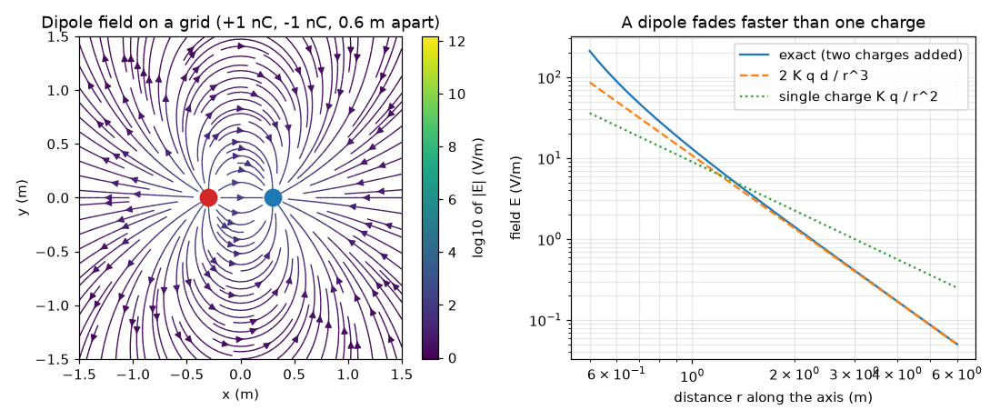
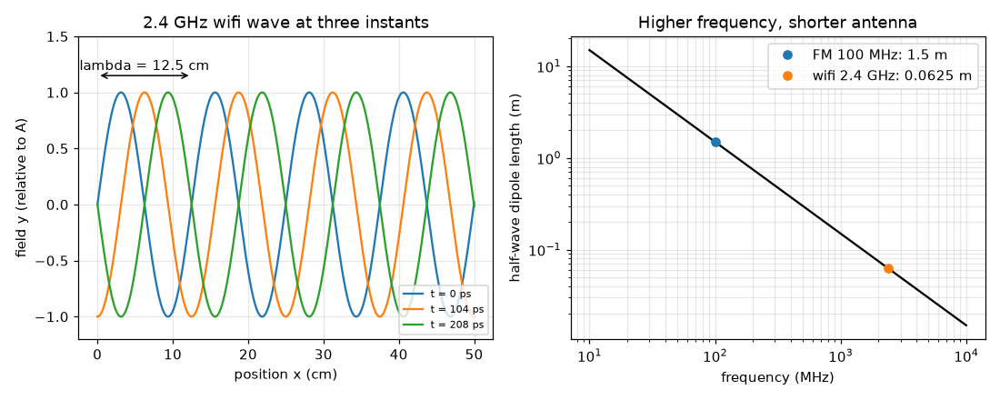

# Session 2: The numbers: Coulomb, superposition and the wave equation

*Level 2 (mathematical engineering model) · about 75 minutes · openemwave*

> This is a simplified educational model. It is not a validated design tool and must not be used for real structures, electrical installations, vehicles, industrial processes or medical decisions.

**Prerequisites**

- Session 1: charges, fields and v = f lambda.
- The sine function and radians (explained again in Section B).

**Learning objectives.** After this session you can:

- Compute the field of a point charge from Coulomb's law and add fields by superposition.
- Compute the field of a dipole on a grid and compare it with the far-field formula.
- Use y = A sin(k x - w t), find k, w and the speed w / k, and compute the wavelength of a wifi signal.
- Design the length of a half-wave dipole antenna from a frequency, and explain polarisation.

## A. Real-world problem
How long must the antenna of an FM radio be, and why is the antenna inside a wifi router only a few centimetres long? The answer is a number, and it comes from the speed of light, the frequency and one rule about how antennas work. Along the way we need to put real numbers on the electric field of charges and write the shape of a wave as one equation.

## B. Concept and theory
Coulomb's law gives the size of the electric field of a point charge q at distance r: E = K |q| / r^2 with the Coulomb constant K about 8.99 x 10^9 N m^2 / C^2. The field points away from a positive charge. Fields add as vectors (superposition), so the field of any set of charges is the sum of the fields of each one; a dipole (+q and -q a distance d apart) has, far along its axis, the field 2 K q d / r^3 which falls faster than a single charge because the two pushes nearly cancel. A travelling wave is written y(x, t) = A sin(k x - w t): A is the amplitude, k = 2 pi / lambda the wavenumber (radians per metre) and w = 2 pi f the angular frequency (radians per second). A crest keeps k x - w t constant, so it moves at v = w / k = f lambda, which is c for light and radio. A half-wave dipole antenna is a straight conductor of length L = lambda / 2: the wave pushes the electrons back and forth along it in step with the wave. The direction of the wave's electric field is its polarisation; an antenna (or a polarising filter) tilted by theta from that direction receives a fraction cos^2(theta) of the power.

| Symbol | Meaning | Unit |
|---|---|---|
| K | Coulomb constant (8.99e9) | N m^2 / C^2 |
| q | charge | C |
| r | distance | m |
| d | separation of the two dipole charges | m |
| A | wave amplitude | same unit as y |
| k | wavenumber 2 pi / lambda | rad/m |
| w | angular frequency 2 pi f | rad/s |
| L | antenna length | m |
| theta | angle between receiver and the electric field direction | degrees |

**Assumptions**

- Point charges at rest in vacuum.
- A plane wave moving in +x, with the field pointing in a fixed direction (linear polarisation).
- The ideal half-wave length lambda / 2; a real thin wire is cut a few percent shorter.
- The dipole formula 2 K q d / r^3 is only valid far away (r much bigger than d).

$$ E=\frac{K\,|q|}{r^{2}},\qquad K\approx 8.99\times10^{9}\ \mathrm{N\,m^{2}/C^{2}} $$

$$ \mathbf E_{\mathrm{total}}=\sum_i \mathbf E_i\quad\text{(superposition)},\qquad E_{\mathrm{dipole}}\approx \frac{2Kqd}{r^{3}}\ \ (r\gg d) $$

$$ y(x,t)=A\sin(kx-\omega t),\qquad k=\frac{2\pi}{\lambda},\ \ \omega=2\pi f,\ \ v=\frac{\omega}{k}=f\lambda $$

$$ L=\frac{\lambda}{2}=\frac{c}{2f},\qquad \frac{P_{\mathrm{received}}}{P_{\max}}=\cos^{2}\theta $$

## C. Visual explanation
The first figure shows the electric field of a dipole computed on a grid by adding the two single-charge fields, and, on the right, the field along the axis against distance on log-log axes: the exact sum, the 2 K q d / r^3 formula and the single-charge K q / r^2 line. The dipole lines have slope -3 against -2 for the single charge, which shows that it fades faster. The second figure shows a 2.4 GHz wave at three instants: the crest moves to the right and the distance between crests is 12.5 cm. Next to it, half-wave antenna length against frequency: 1.5 m at 100 MHz and 6.2 cm at 2.4 GHz.

*A dipole computed on a grid, and its field on the axis against distance.*

*A 2.4 GHz wave at three instants, and half-wave antenna length against frequency.*

## D. Interactive simulation
Run the lesson (`python start.py 2`), then open the live app: [Session 2: wavelength and antenna length](https://krunalpanchal1995.github.io/openemwave/session-02/) (or `app.html` in this folder). Slide the frequency and watch the half-wave length (red line) move; then change your own antenna length and see what percentage of lambda / 2 it is.

**Challenge.** Design the antenna for an FM station at 100 MHz: set the frequency to 100 MHz and the length within 3 percent of the half-wave length.

## E. Worked example and experiment
**Problem.** A 2.4 GHz wifi wave: find lambda, k, w and check that w / k = c. Then find the half-wave antenna length. Finally compute the field of a 1 nC charge at 0.5 m.

1. lambda = c / f = 2.998e8 / 2.4e9 = 0.1249 m = 12.5 cm.
2. k = 2 pi / lambda = 6.283 / 0.1249 = 50.3 rad/m.
3. w = 2 pi f = 6.283 x 2.4e9 = 1.508e10 rad/s.
4. Check: w / k = 1.508e10 / 50.3 = 3.00e8 m/s, which is c.
5. Half-wave antenna: L = lambda / 2 = 0.0625 m = 6.2 cm.
6. Coulomb: E = K q / r^2 = 8.99e9 x 1e-9 / 0.5^2 = 8.99 / 0.25 = 35.96 V/m, about 36 V/m.

**Answer.** lambda = 12.5 cm, k = 50.3 rad/m, w = 1.508e10 rad/s, v = w / k = c, antenna 6.2 cm; and 36 V/m for 1 nC at 0.5 m.

**Experiment.** Measure the antenna on a wifi router or a USB wifi dongle: many are a few centimetres long, close to 6 cm. Real antennas are shortened by the wire thickness and often folded, and the router casing and nearby metal change how they behave. Compare also a heating wire: a 6.2 cm piece is not an antenna unless it is fed by the right circuit, so length alone is not the whole story.

## F. Assessment and design challenge
**Question type A: Conceptual.** Why does the field of a dipole fall off as 1/r^3 while the field of a single charge falls off as 1/r^2? What would happen if the two charges had the same sign?

Hint

At a large distance the two fields point almost the same way but have opposite signs for a dipole.

Step-by-step solution

For a dipole the two charges are almost the same distance away, so their fields are almost equal and opposite and nearly cancel; only the small difference caused by the separation d remains, which is why the result is smaller and falls faster (2 K q d / r^3). With the same sign the fields would add instead of cancel and the far field would look like a single charge of size 2q, falling as 1/r^2.

**Question type B: Numerical.** A 2 nC charge. Find the field 0.3 m away. Then find the field if the distance is doubled, and sanity-check the ratio.

Hint

E = K q / r^2 with q = 2e-9 C.

Step-by-step solution

E(0.3) = 8.99e9 x 2e-9 / 0.09 = 17.98 / 0.09 = 199.8 V/m, about 200 V/m. At 0.6 m: 17.98 / 0.36 = 49.9 V/m. The ratio 199.8 / 49.9 = 4, as expected for an inverse square law (double the distance, a quarter of the field).

**Question type C: Graph and simulation interpretation.** In the log-log graph of dipole field against distance, the curves for the exact dipole and for 2 K q d / r^3 touch at large r but separate at small r. Where do they separate and why? Which line is steeper, the dipole or the single charge?

Hint

The formula assumes r is much bigger than d.

Step-by-step solution

They separate at small r, close to the charges (at r = 0.5 m with d = 0.6 m the formula is not valid because r is not much larger than d), and agree for large r. The dipole line is steeper (slope -3) than the single-charge line (slope -2).

**Question type D: Design and optimisation challenge.** Design: choose the length of a half-wave dipole for an FM station at 100 MHz. A rod can be bought only in whole centimetres and your radio case is 1.2 m long. What length do you choose, and what trade-off does a shorter rod cause?

Hint

L = c / (2 f); then compare with what fits.

Step-by-step solution

L = 2.998e8 / (2 x 1e8) = 1.499 m, about 1.5 m, which does not fit in a 1.2 m case. Options: fold or telescope it, or use a shorter antenna (for example a quarter-wave, 0.75 m, over a conducting plane). A shorter rod than lambda / 2 still receives, but it is a poorer match to the wave, so the received signal is weaker. Assumption: ideal thin rod; a real one is cut a few percent shorter.

Score yourself with [RUBRIC.md](../../RUBRIC.md). Print the [activity sheet](activity_sheet.md) to work on paper.

## Common misconceptions
| Common misconception | What is actually true |
|---|---|
| Adding two charges' fields means adding the numbers. | Fields are vectors: they add with direction, so they can cancel, as in a dipole. |
| The dipole field is just weaker than a single charge's field by a constant. | It falls with a different power, 1/r^3 instead of 1/r^2, because of cancellation. |
| The wave speed is f times the amplitude. | The speed is f times the wavelength, v = w / k; the amplitude says how big the wave is, not how fast it goes. |
| An antenna works at any length. | It works best near lambda / 2 (or other resonant lengths); the right length depends on the frequency. |

## Glossary
- **superposition**: the total field is the vector sum of the fields of each source
- **wavenumber**: k = 2 pi / lambda, how many radians of the wave fit in one metre
- **angular frequency**: w = 2 pi f, radians of phase per second
- **half-wave dipole**: a straight antenna whose length is half a wavelength
- **polarisation**: the direction in which the electric field of a wave points

## Finish
1. Do the three coding tasks in [exercises.md](exercises.md).
2. Run `python start.py 2` again after your changes. It ends with the checkpoint; when it prints `PASS`, you are done. (Checkpoint only: `python start.py check 2`.)

Next: [Session 3](../session-03/README.md)
