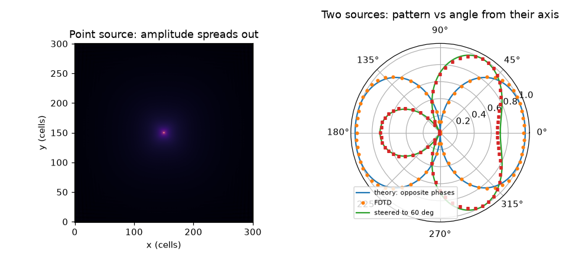
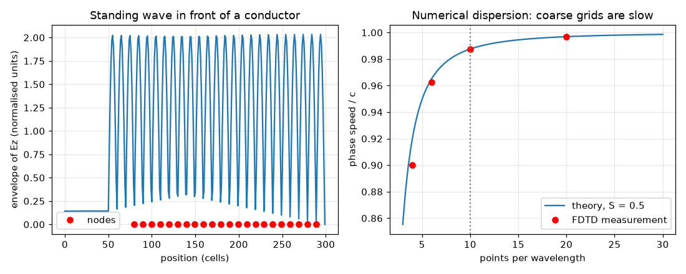

# Session 3: A wave simulator you can trust: FDTD

*Level 3 (simulation and validation) · about 90 minutes · openemwave*

> This is a simplified educational model. It is not a validated design tool and must not be used for real structures, electrical installations, vehicles, industrial processes or medical decisions.

**Prerequisites**

- Session 2: wavelength, v = f lambda, half-wave antennas.
- Arrays in NumPy (slicing such as a[1:] - a[:-1]); Section B recalls what a derivative is.

**Learning objectives.** After this session you can:

- Write a 1D and 2D FDTD simulation of Ez, Hx and Hy on a Yee grid in normalised units.
- Validate it: measure the wave speed, check energy conservation and see the Courant condition fail.
- Measure the 1/sqrt(r) fall-off of a 2D wave and the lambda / 2 spacing of standing-wave nodes.
- Find when the simulator is wrong (too few points per wavelength) and use two sources to make and steer a radiation pattern.

## A. Real-world problem
Engineers cannot solve Maxwell's equations by hand for a phone antenna or a router in a room, so they simulate the fields on a computer grid and march them forward in time. But a simulation can look beautiful and still be wrong. How do you know that a simulator tells the truth, and when is it lying? Today you build one and test it against five things you already know from theory.

## B. Concept and theory
Maxwell's equations say that a changing magnetic field makes an electric field and a changing electric field makes a magnetic field. In the TMz picture of 2D (electric field Ez out of the page, magnetic field Hx, Hy in the page) and in normalised units with c = 1, eps = mu = 1, the equations become: dHx/dt = -dEz/dy, dHy/dt = dEz/dx, dEz/dt = dHy/dx - dHx/dy. The FDTD method (finite-difference time-domain) puts Ez on whole grid points and Hx, Hy half a cell away (the Yee grid) and updates E and H alternately in half-steps (leapfrog). With the Courant number S = c dt / dx, each update adds S times a difference of neighbouring values. The scheme is stable only if S <= 1 in 1D and S <= 1/sqrt(2) in 2D (dt <= dx / (c sqrt 2)); above that, tiny errors grow every step and the field blows up. Even when stable, a grid slows short waves: the numerical phase speed obeys sin(w dt / 2) = S sin(k dx / 2), which is about 1 - (k dx)^2 (1 - S^2) / 24 of c, so waves with fewer than about 10 points per wavelength travel noticeably too slowly (numerical dispersion). The grid edge needs an absorbing condition (here the simple first-order Mur rule) or the wave would echo back; a perfect conductor wall (Ez = 0) reflects the wave and makes a standing wave with nodes lambda / 2 apart. A line source in 2D radiates a cylindrical wave whose amplitude falls as 1/sqrt(r) (its power spreads over a circle of length 2 pi r), while a 3D point source falls as 1/r. Two sources a distance d apart with phase difference delta give a far-field amplitude |cos((k d cos(theta) + delta) / 2)|; the beam points where k d cos(theta) + delta = 0, so changing delta steers it.

| Symbol | Meaning | Unit |
|---|---|---|
| Ez, Hx, Hy | field components in the simulation | normalised units (E and H have the same scale because Z0 = 1) |
| dx | grid cell size | one cell (unit of length) |
| dt, S | time step; Courant number c dt / dx | dt in cell-crossing times; S has no unit |
| ppw | points (cells) per wavelength | no unit |
| lambda, k | wavelength in cells; wavenumber 2 pi / lambda | cells; rad/cell |
| d, delta | source spacing; phase of the second source | cells (or lambda); radians |
| theta | angle from the line joining the sources | degrees or radians |

**Assumptions**

- Normalised units: dx = 1, c = 1, vacuum everywhere, perfect conductors have Ez = 0.
- TMz polarisation in 2D (an infinitely long line source along z), not a full 3D antenna.
- First-order Mur boundary: it absorbs waves that hit it head-on well, but leaves a small echo at other angles (we measure it).
- Educational solver; real antenna design needs 3D, material models and better absorbers.

$$ \frac{\partial H_x}{\partial t}=-\frac{\partial E_z}{\partial y},\quad \frac{\partial H_y}{\partial t}=\frac{\partial E_z}{\partial x},\quad \frac{\partial E_z}{\partial t}=\frac{\partial H_y}{\partial x}-\frac{\partial H_x}{\partial y} $$

$$ E_z^{n+1}=E_z^{n}+S\left[(H_y)_{i}-(H_y)_{i-1}-(H_x)_{j}+(H_x)_{j-1}\right],\qquad S=\frac{c\,\Delta t}{\Delta x} $$

$$ \Delta t\le \frac{\Delta x}{c\sqrt{2}}\ \text{(2D)},\qquad \sin\frac{\omega\Delta t}{2}=S\sin\frac{k\Delta x}{2} $$

$$ |E_z|\propto \frac{1}{\sqrt r}\ \text{(2D wave)},\qquad \text{node spacing}=\frac{\lambda}{2},\qquad |E|\propto\left|\cos\frac{kd\cos\theta+\delta}{2}\right| $$

## C. Visual explanation
The first figure shows the standing wave in front of a conductor (the envelope of Ez has nodes about 10 cells apart, which is lambda / 2 for lambda = 20 cells) and the numerical phase speed against points per wavelength: the theory curve and the FDTD measurements lie on top of each other, and the grid is 1 percent slow at about 11 points per wavelength and gets worse quickly below that. The second figure shows the amplitude map of a point source (rings spreading and fading) and the polar pattern of two sources: opposite phases give a figure eight along the axis, and a -90 degree phase difference steers the beam to 60 degrees, with the simulation dots on top of the theory curves.

*Amplitude map of a point source, and the polar pattern of two sources: theory against simulation.*

*Standing wave nodes in front of a conductor, and numerical phase speed against points per wavelength.*

## D. Interactive simulation
Run the lesson (`python start.py 3`), then open the live app: [Session 3: patterns and numerical dispersion](https://krunalpanchal1995.github.io/openemwave/session-03/) (or `app.html` in this folder). In the polar view, change the spacing and the phase to move the beam; in the dispersion view move the points per wavelength and the Courant number and watch where the grid error crosses the 1 percent line.

**Challenge.** Steer the main beam to 60 degrees from the line joining the sources, with a spacing of at most half a wavelength (so no grating lobe).

## E. Worked example and experiment
**Problem.** You want to simulate a 2.4 GHz wifi wave in a 1 m square room with 20 cells per wavelength. Find the cell size, the largest stable time step in 2D, the number of steps per wave period and the number of cells across the room.

1. Wavelength: lambda = c / f = 2.998e8 / 2.4e9 = 0.1249 m.
2. Cell size: dx = lambda / 20 = 0.1249 / 20 = 6.25 mm.
3. Cells across 1 m: 1 / 0.006246 = 160 cells.
4. Courant limit in 2D: dt <= dx / (c sqrt 2) = 6.246e-3 / (2.998e8 x 1.4142) = 14.73 ps.
5. Period T = 1 / 2.4e9 = 416.7 ps, so the number of steps per period is 416.7 / 14.73 = 28.3 at the limit (more steps are needed if S is smaller than the limit).

**Answer.** dx = 6.25 mm, 160 cells across, dt at most 14.73 ps, about 28 steps per period at the limit.

**Experiment.** Compare with a real measurement: a wifi signal at 2.4 GHz in a room shows signal strength going up and down every few centimetres as you move a phone (standing waves from walls), as in Step 2 of the lesson, though the real room is 3D and has furniture and many reflections. A simulator with 20 points per wavelength should place the nodes within about 1 percent; a real measurement is also limited by the phone's antenna and orientation, which the model leaves out.

## Real-world application and mini-project: Steer a beam with two sources
A small-cell radio needs its beam to point 45 degrees away from the line joining its two antennas. The two sources are half a wavelength apart (5 cells at 10 points per wavelength). Use `ring_pattern` and `beam_phase` from Session 3: the hand calculation tells you roughly what phase difference to use, the simulation tells you what you really get.

**Deliverable:** A script that, for phase differences from -150 to -100 degrees in steps of 5, runs `ring_pattern(delta=..., n_angles=180)`, prints the measured beam direction in the upper half-plane next to the hand-calculated one from `beam_phase`, names the phase whose measured beam is closest to 45 degrees, and saves a polar plot of that pattern.

**Success looks like:** The reported phase is -130 degrees (measured beam 44 degrees; the hand calculation gives -127 degrees) and its measured direction is within 3 degrees of 45. With phase 0 the same pair points at 90 degrees, so the phase really is the steering lever.

## F. Assessment and design challenge
**Question type A: Conceptual.** Why does a time step above the Courant limit make the simulation blow up, even though the true wave equation is perfectly well behaved? What does S mean physically?

Hint

S = c dt / dx is the fraction of a cell the wave crosses in one step.

Step-by-step solution

S is the fraction of a cell the wave travels in one time step. If S is too large the numerical scheme asks a cell to depend on information that physically has not yet reached it; the rounding error that is always present is then amplified every step instead of damped, and it grows exponentially. The true equation does not have this problem, so the blow-up is a property of the discretisation. In 2D the limit is 1/sqrt(2) because the wave can also travel along the diagonal of a cell.

**Question type B: Numerical.** A grid has 8 points per wavelength and S = 0.5. Estimate the numerical phase speed as a fraction of c using 1 - (k dx)^2 (1 - S^2) / 24, and say whether the grid is good enough for a 1 percent accuracy.

Hint

k dx = 2 pi / ppw.

Step-by-step solution

k dx = 2 pi / 8 = 0.785. (k dx)^2 = 0.617. (1 - S^2) = 0.75. So the error is 0.617 x 0.75 / 24 = 0.0193 and the phase speed is about 0.981 c, 1.9 percent slow. That is worse than 1 percent, so 8 points per wavelength is not enough; at 10 points per wavelength the error is 1.2 percent and at 12 about 0.9 percent.

**Question type C: Graph and simulation interpretation.** In the point-source amplitude measurement, the fitted slope on a log-log graph is -0.499. What does a slope of -0.5 mean, and what slope would a 3D source give? What would a slope of -1 in the 2D simulation tell you?

Hint

Amplitude ~ r^p, so the slope of log(amplitude) against log(r) is p.

Step-by-step solution

A slope of -0.5 means amplitude falls as 1/sqrt(r): as r grows 4 times, amplitude halves; power (amplitude squared) falls as 1/r, because it spreads over a circle of length 2 pi r. A 3D point source spreads over a sphere of area 4 pi r^2, so power falls as 1/r^2 and amplitude as 1/r: slope -1. A slope of -1 in the 2D run would signal that energy is being lost (for example a very absorbing medium) or a mistake in the measurement, such as measuring too close to the source or after the wave hit a boundary.

**Question type D: Design and optimisation challenge.** Design: choose the phase difference between two sources a half wavelength apart so that the main beam points 45 degrees from their line, and say whether a spacing of 0.8 lambda is a good idea. Use the hand calculation, then say what you would check in the simulation.

Hint

cos(theta0) = -delta / (k d). Compare k d with 2 pi.

Step-by-step solution

k d = 2 pi x 0.5 = pi, cos 45 = 0.707, so delta = -pi x 0.707 = -2.22 rad = -127 degrees (a phase step of -130 degrees in the simulation gives about 44 degrees). A spacing of 0.8 lambda is a poor idea: with k d = 1.6 pi a second solution of k d cos(theta) + delta = 2 pi appears, a grating lobe, so a second unwanted beam appears. In the simulation check that the measured peak on the ring is within a few degrees of 45 and that there is no second lobe of similar size. Trade-off: a wider spacing gives a narrower beam but risks grating lobes.

Score yourself with [RUBRIC.md](../../RUBRIC.md). Print the [activity sheet](activity_sheet.md) to work on paper.

## Common misconceptions
| Common misconception | What is actually true |
|---|---|
| If the animation looks smooth, the simulation is right. | It can be smoothly wrong: a stable but coarse grid gives waves of the wrong speed. Always compare with an analytic result. |
| A smaller time step is always better. | Below the Courant limit it is stable, but the accuracy in 1D is best at S = 1 (exact) and gets worse as S decreases; the grid size decides accuracy more than dt. |
| The 2D wave falls as 1/r like in the 3D world. | A 2D (line-source) wave falls as 1/sqrt(r); the 1/r law is for a point source in 3D. |
| An absorbing boundary absorbs everything. | The simple Mur rule absorbs well head-on but reflects a few percent at other angles; better boundaries are a roadmap item. |

## Glossary
- **FDTD**: finite-difference time-domain: step Maxwell's equations forward in time on a grid
- **Yee grid**: E and H stored half a cell apart and updated in turn
- **Courant number**: S = c dt / dx, the fraction of a cell a wave crosses in one step
- **numerical dispersion**: wrong wave speed caused by the grid, worst for short waves
- **standing wave**: a pattern that does not travel, made by a wave and its reflection; nodes are lambda / 2 apart
- **array factor**: the pattern of a group of sources, from the phase of each one

## Finish
1. Do the three coding tasks in [exercises.md](exercises.md).
2. Run `python start.py 3` again after your changes. It ends with the checkpoint; when it prints `PASS`, you are done. (Checkpoint only: `python start.py check 3`.)

Next: the [roadmap](../../promo/roadmap.md). Session 4 is yours to build.
